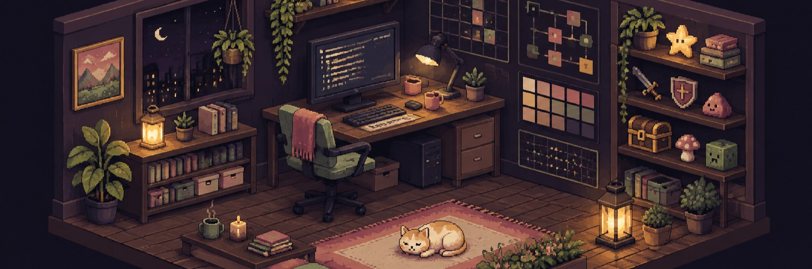
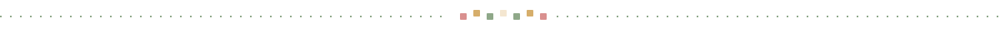

  

<h1 align="center">JEuichan</h1>

  <strong>Planning and building games, end to end.</strong> 
  기획부터 개발까지 직접 만들어 출시하는 것을 좋아합니다.

  <a href="#hello">Hello</a>&nbsp;&nbsp;·&nbsp;&nbsp;
  <a href="#currently">Currently</a>&nbsp;&nbsp;·&nbsp;&nbsp;
  <a href="#selected-work">Selected work</a>&nbsp;&nbsp;·&nbsp;&nbsp;
  <a href="#toolbox">Toolbox</a>&nbsp;&nbsp;·&nbsp;&nbsp;
  <a href="#connect">Connect</a>

 

## Hello

부산대학교 **정보컴퓨터공학부**에서 공부하고 있는 정의찬입니다.

아이디어를 기획서로 끝내지 않고 **실제로 출시되는 제품까지** 밀고 가는 과정에 관심이 많습니다.
지금은 게임을 만들면서, 기획과 개발과 디자인을 한 사람이 어디까지 감당할 수 있는지 실험하고 있습니다.

## Currently

- 🎮 스팀 출시를 목표로 게임 개발 중 — `Unity 6` · `C#`
- 🚀 **AI/SW 마에스트로** 과정 참여 중 (한국정보산업연합회)
- 🧭 AI 도구를 개발 워크플로에 붙이는 방법을 계속 다듬는 중

## Selected work

### 신규 스팀 게임 · 개발 중

기획 · 개발 · 디자인을 직접 맡아 만들고 있는 데스크탑 게임입니다. 스팀 출시를 목표로 진행 중입니다.

`기획 · 개발 · 디자인` &nbsp;·&nbsp; `C# · Unity 6` &nbsp;·&nbsp; `2026 —`

- 콘텐츠 기획부터 구현까지 전 과정을 직접 담당
- Supabase · AWS S3 · Steam Cloud 로 저장과 동기화 구성
- Codex · Claude 를 개발 파이프라인에 상시 투입

 

**Also here** &nbsp; `daily-assistant-langgraph` · `ai-learning-app` · `my_streamlit_app` · `Algorithm`

## Toolbox

| | |
|---|---|
| **Languages** | `Python` · `C#` · `C++` · `C` · `JavaScript` |
| **Game** | `Unity 6` |
| **Backend · Cloud** | `Supabase` · `AWS S3` · `Steam Cloud` |
| **AI** | `Claude` · `Codex` |

## Connect

- GitHub — [@JEuichan](https://github.com/JEuichan)
- Email — wjddmlcks22@gmail.com

 

  
  Thanks for stopping by.

